# 📊 EMS 3.0 — Comprehensive Project Architecture & Technical Analysis

> **Product:** Employee Monitoring System (EMS 3.0)  
> **Repository Root:** `d:/EMS 3.0`  
> **Analysis Date:** October 2026  
> **Status:** Production-Ready Full-Stack Enterprise Platform

---

## 1. Executive Summary & System Topology

**EMS 3.0** is an enterprise-grade workforce analytics, remote employee monitoring, and organizational management suite. The project is structured as a monorepo containing three core subsystems:

```mermaid
graph TD
    subgraph Workstation["Employee Workstation (Windows 10/11)"]
        Agent["Desktop Agent (Java 17 / Swing / JNA)<br/>[AgentApplication](file:///d:/EMS%203.0/employee-agent/src/main/java/org/example/AgentApplication.java)"]
        JNA["Win32 JNA Hooks<br/>[UserActivityMonitor](file:///d:/EMS%203.0/employee-agent/src/main/java/org/example/activity/UserActivityMonitor.java)<br/>[ActiveWindowService](file:///d:/EMS%203.0/employee-agent/src/main/java/org/example/activity/ActiveWindowService.java)"]
        LocalQueue["Offline Queue (SQLite/Disk)<br/>[PersistentAttendanceQueue](file:///d:/EMS%203.0/employee-agent/src/main/java/org/example/attendance/PersistentAttendanceQueue.java)"]
        OTAClient["OTA Engine<br/>[OtaUpdateService](file:///d:/EMS%203.0/employee-agent/src/main/java/org/example/ota/OtaUpdateService.java)"]
        Agent --> JNA
        Agent --> LocalQueue
        Agent --> OTAClient
    end

    subgraph CloudBackend["Core Backend Service (Port 8082 / Nginx)"]
        SpringAPI["Spring Boot 3.x REST API<br/>[EmsApplication](file:///d:/EMS%203.0/employee/src/main/java/com/example/employee/EmsApplication.java)"]
        Security["Spring Security + JWT<br/>[SecurityConfig](file:///d:/EMS%203.0/employee/src/main/java/com/example/employee/config/SecurityConfig.java)"]
        TelemetryEngine["Tracking & Aggregation Engine<br/>[AdminTrackingController](file:///d:/EMS%203.0/employee/src/main/java/com/example/employee/controller/api/admin/AdminTrackingController.java)"]
        TimesheetEngine["Timesheet & Efficiency Engine<br/>[EmployeeTimesheetService](file:///d:/EMS%203.0/employee/src/main/java/com/example/employee/service/EmployeeTimesheetService.java)"]
        OTAServer["OTA Distribution Controller<br/>[AgentUpdateController](file:///d:/EMS%203.0/employee/src/main/java/com/example/employee/controller/AgentUpdateController.java)"]
        SpringAPI --> Security
        SpringAPI --> TelemetryEngine
        SpringAPI --> TimesheetEngine
        SpringAPI --> OTAServer
    end

    subgraph Database["Data Persistence"]
        MongoDB[("MongoDB Atlas<br/>Multi-tenant / Clustered")]
    end

    subgraph AdminFrontend["Management Dashboard (Port 5174 / Web)"]
        AdminUI["React 19 + TypeScript + Vite SPA<br/>[App.tsx](file:///d:/EMS%203.0/admin-ui/src/App.tsx)"]
        Dashboards["Live Analytics & Recharts<br/>[TimeTrackingSummary.tsx](file:///d:/EMS%203.0/admin-ui/src/pages/TimeTrackingSummary.tsx)<br/>[EmployeeTimesheet.tsx](file:///d:/EMS%203.0/admin-ui/src/pages/EmployeeTimesheet.tsx)"]
        AdminUI --> Dashboards
    end

    Agent -- "HTTPS / TLS 1.3 Telemetry & Events" --> SpringAPI
    OTAClient -- "Check & Download MSI" --> OTAServer
    SpringAPI --> MongoDB
    AdminUI -- "REST / JWT Authenticated Calls" --> SpringAPI
```

---

## 2. Subsystem 1: Core Backend API (`/employee`)

### 2.1 Technology Stack & Runtime Configuration
- **Runtime:** Java 17 (OpenJDK 17 LTS), Spring Boot 3.x.
- **Database:** MongoDB Atlas (Cloud Replica Set) via Spring Data Mongo with automatic indexing (`spring.data.mongodb.auto-index-creation=true`).
- **Security:** Spring Security 6 with stateless JWT authentication filter (`JwtRequestFilter`), BCrypt password hashing.
- **Monitoring & Metrics:** Spring Boot Actuator (`health`, `info`, `prometheus` exposed).
- **Configuration File:** [`application.properties`](file:///d:/EMS%203.0/employee/src/main/resources/application.properties) with support for `/opt/ems/env.properties` external overrides. Default port is `8082`.

### 2.2 Key Domain Models (`/model`)
1. [`Employee`](file:///d:/EMS%203.0/employee/src/main/java/com/example/employee/model/Employee.java): Master employee entity with `employeeCode`, credentials, role (`ROLE_ADMIN` / `ROLE_EMPLOYEE`), personal info, and associations to department and team.
2. [`AttendanceEventDocument`](file:///d:/EMS%203.0/employee/src/main/java/com/example/employee/model/AttendanceEventDocument.java): High-frequency event stream recording state transitions (`WORK_STARTED`, `WORK_ENDED`, `IDLE_STARTED`, `IDLE_ENDED`, `BREAK_STARTED`, `BREAK_ENDED`, `LUNCH_STARTED`, `LUNCH_ENDED`).
3. [`ApplicationActivityDocument`](file:///d:/EMS%203.0/employee/src/main/java/com/example/employee/model/ApplicationActivityDocument.java): Detailed telemetry logging active window title, process name (e.g. `chrome.exe`, `idea64.exe`), website domain/URL, and duration.
4. [`Device`](file:///d:/EMS%203.0/employee/src/main/java/com/example/employee/model/Device.java): Registered hardware endpoint capturing hardware UUID, hostname, OS, IP address, resolved location, agent version, and last seen timestamp.
5. [`Task`](file:///d:/EMS%203.0/employee/src/main/java/com/example/employee/model/Task.java) & [`EmployeeTaskWork`](file:///d:/EMS%203.0/employee/src/main/java/com/example/employee/model/EmployeeTaskWork.java): Task tracking module allowing managers to assign projects and employees to track granular effort per task.
6. [`AgentUpdate`](file:///d:/EMS%203.0/employee/src/main/java/com/example/employee/model/AgentUpdate.java): Release records storing MSI file path, SHA-256 integrity hash, target version, mandatory flag, and active status.
7. [`Screenshot`](file:///d:/EMS%203.0/employee/src/main/java/com/example/employee/model/Screenshot.java) & [`ScreenshotMonitor`](file:///d:/EMS%203.0/employee/src/main/java/com/example/employee/model/ScreenshotMonitor.java): Binary screenshot storage and interval configuration per employee.

### 2.3 Core Services & Business Logic
- [`AdminTrackingController`](file:///d:/EMS%203.0/employee/src/main/java/com/example/employee/controller/api/admin/AdminTrackingController.java):
  - Ingests and aggregates live device heartbeats and activity states.
  - Generates state-machine transitions across historical timestamp events to calculate: `workSeconds`, `idleSeconds`, `breakSeconds`, `lunchSeconds`, and `efficiency`.
  - Integrates external IP/Geo-lookup with caching for employee location tracking.
- [`EmployeeTimesheetService`](file:///d:/EMS%203.0/employee/src/main/java/com/example/employee/service/EmployeeTimesheetService.java):
  - Assembles organizational timesheets across Day, Week, Month, and Year intervals.
  - Normalizes working hours against daily policy (`workday.required-hours=9`).
- [`AgentUpdateService`](file:///d:/EMS%203.0/employee/src/main/java/com/example/employee/service/AgentUpdateService.java) & [`AgentUpdateFileService`](file:///d:/EMS%203.0/employee/src/main/java/com/example/employee/service/AgentUpdateFileService.java):
  - Handles multipart MSI package uploads (`/var/lib/ems/agent-updates`), SHA-256 checksum computation, and distribution to desktop clients.

---

## 3. Subsystem 2: Windows Desktop Agent (`/employee-agent`)

### 3.1 Technology Stack & Architectural Design
- **Runtime:** Java 17 packaged as a self-contained native executable using `jpackage` and WiX Toolset v3.14.
- **UI Framework:** Java Swing with a custom high-DPI modern design system ([`UITheme`](file:///d:/EMS%203.0/employee-agent/src/main/java/org/example/ui/theme/UITheme.java), custom rounded containers, vector icon renders, system tray integration via [`AppTrayManager`](file:///d:/EMS%203.0/employee-agent/src/main/java/org/example/ui/AppTrayManager.java)).
- **Native OS Interop:** Java Native Access (JNA) bindings to Windows `user32.dll` and `kernel32.dll`.

### 3.2 Operating Loops & Monitoring Pipelines
1. **Single Instance Enforcement:**
   - [`AgentApplication.java:L198`](file:///d:/EMS%203.0/employee-agent/src/main/java/org/example/AgentApplication.java#L198-L203): Employs a dual-lock system (local loopback `ServerSocket` + OS file lock on `%TEMP%`) preventing duplicate background instances.
2. **Idle Detection without Keylogging:**
   - [`UserActivityMonitor.java`](file:///d:/EMS%203.0/employee-agent/src/main/java/org/example/activity/UserActivityMonitor.java): Calls Windows API `GetLastInputInfo` and `GetTickCount`. Calculates exact millisecond gap since last hardware input across mouse/keyboard without recording keystrokes, preserving employee privacy.
   - When inactivity exceeds threshold (configured via server or 120s default), triggers `IDLE_STARTED`. Resuming input triggers `IDLE_ENDED`.
3. **Active Application & Browser Tab Tracking:**
   - [`ActiveWindowService.java`](file:///d:/EMS%203.0/employee-agent/src/main/java/org/example/activity/ActiveWindowService.java): Queries `GetForegroundWindow`, `GetWindowTextW`, and `GetWindowThreadProcessId` every polling cycle.
   - Parses process names (`chrome.exe`, `msedge.exe`, `code.exe`, `excel.exe`) and maps them to application or website domain metrics.
4. **Resilient Offline Mode & Persistent Queue:**
   - [`PersistentAttendanceQueue.java`](file:///d:/EMS%203.0/employee-agent/src/main/java/org/example/attendance/PersistentAttendanceQueue.java): If network connectivity fails, events are cached on local disk with transactional locking.
   - [`AttendanceEventQueueProcessor.java`](file:///d:/EMS%203.0/employee-agent/src/main/java/org/example/attendance/AttendanceEventQueueProcessor.java): Background thread monitors server connectivity and automatically drains/flushes queued events in chronological order once connectivity resumes.
5. **Over-The-Air (OTA) Self-Updating:**
   - [`OtaUpdateService.java`](file:///d:/EMS%203.0/employee-agent/src/main/java/org/example/ota/OtaUpdateService.java): Periodic HTTP check to `/api/v1/agent-updates/latest`.
   - Downloads new MSI to `C:\ProgramData\EmployeeAgent\updates`, computes SHA-256 checksum to verify integrity against backend metadata, marks update flag, triggers silent installer `msiexec.exe /i "..." /qn`, and restarts the agent preserving user session via Windows Credential Manager.

---

## 4. Subsystem 3: Admin Web Dashboard (`/admin-ui`)

### 4.1 Technology Stack
- **Framework:** React 19 SPA with Vite bundler and TypeScript (~6.0).
- **Styling:** Tailwind CSS 4 with custom dark mode toggle support.
- **Routing:** React Router DOM v7 with [`ProtectedRoute`](file:///d:/EMS%203.0/admin-ui/src/App.tsx#L24-L32) authentication guards.
- **Data Visualization & Exports:** Recharts for telemetry charts, `exceljs` for multi-tab Excel export, `react-to-print` for print-ready timesheet layouts, `react-toastify` for notifications.

### 4.2 Application Page Matrix
| Page Component | Route | Core Functionality |
| :--- | :--- | :--- |
| [`Dashboard.tsx`](file:///d:/EMS%203.0/admin-ui/src/pages/Dashboard.tsx) | `/` | High-level KPI summary cards (Employees, Tasks, Teams, Departments). |
| [`TimeTrackingSummary.tsx`](file:///d:/EMS%203.0/admin-ui/src/pages/TimeTrackingSummary.tsx) | `/time-tracking` | Real-time monitoring center: live device status grid, activity badges (WORKING, IDLE, BREAK, LUNCH), date preset filters, application & website usage breakdown, and visual timeline modal. |
| [`EmployeeTimesheet.tsx`](file:///d:/EMS%203.0/admin-ui/src/pages/EmployeeTimesheet.tsx) | `/tracking/timesheet` | Granular timesheet engine with Day, Week, Month, and Year aggregations, Recharts workload distribution, Excel download, and multi-format print layouts. |
| [`Attendance.tsx`](file:///d:/EMS%203.0/admin-ui/src/pages/Attendance.tsx) | `/tracking/attendance` | Daily attendance ledger, status filters (Present, Absent, On Leave), check-in/out timestamps, and working hours calculation. |
| [`AddEmployee.tsx`](file:///d:/EMS%203.0/admin-ui/src/pages/AddEmployee.tsx) / [`ViewEmployee.tsx`](file:///d:/EMS%203.0/admin-ui/src/pages/ViewEmployee.tsx) | `/employees/*` | Full employee lifecycle: personal details, company credentials, salary/joining dates, emergency contacts, documents, and status toggling. |
| [`AssignTask.tsx`](file:///d:/EMS%203.0/admin-ui/src/pages/AssignTask.tsx) / [`TaskList.tsx`](file:///d:/EMS%203.0/admin-ui/src/pages/TaskList.tsx) | `/tasks/*` | Task management: project assignment, priority tags (Urgent, High, Medium, Low), deadlines, status workflow, and completion tracking. |
| [`AddDepartment.tsx`](file:///d:/EMS%203.0/admin-ui/src/pages/AddDepartment.tsx) / [`ViewDepartments.tsx`](file:///d:/EMS%203.0/admin-ui/src/pages/ViewDepartments.tsx) | `/departments/*` | Organizational hierarchy configuration. |
| [`AddTeam.tsx`](file:///d:/EMS%203.0/admin-ui/src/pages/AddTeam.tsx) / [`ViewTeams.tsx`](file:///d:/EMS%203.0/admin-ui/src/pages/ViewTeams.tsx) | `/teams/*` | Team structure linked to parent departments. |
| [`AdminProfile.tsx`](file:///d:/EMS%203.0/admin-ui/src/pages/AdminProfile.tsx) | `/settings` | Admin profile, credentials, password change, and security settings. |

---

## 5. Security & Authentication Architecture

1. **Stateless JWT Flow:**
   - Both web dashboard and desktop agents authenticate via `/api/auth/login` or `/api/agent/login`.
   - Backend issues standard stateless JWT with customizable validity (`jwt.expiration=32400000` / 9 hours).
   - Desktop client additionally receives refresh tokens for unattended sessions.
2. **Role-Based Access Control (RBAC):**
   - Configured in [`SecurityConfig.java:L61-L79`](file:///d:/EMS%203.0/employee/src/main/java/com/example/employee/config/SecurityConfig.java#L61-L79).
   - `/api/admin/**` endpoints are strictly restricted to `ROLE_ADMIN`.
   - `/api/employee/**` endpoints require `ROLE_EMPLOYEE`.
   - Static assets, login endpoints, and OTA download streams are cleanly whitelisted.
3. **Endpoint Protection & Credential Storage:**
   - Passwords stored as BCrypt hashes.
   - Desktop agent credentials stored safely using Windows Credential Manager (`wincred`) rather than plaintext configuration files.
4. **Privacy-Preserving Telemetry:**
   - Keystroke logging is deliberately avoided; instead, OS-level last-input timers are queried to detect active vs. idle state.

---

## 6. Packaging, Deployment & Operations

### 6.1 Desktop Agent MSI Packaging
- Located in [`employee-agent/packaging/build-msi.ps1`](file:///d:/EMS%203.0/employee-agent/packaging/build-msi.ps1).
- Uses `jpackage` to bundle a minimal Java 17 runtime directly inside the MSI installer.
- Incorporates a fixed `UpgradeCode` GUID (`8B3D4A29-F5E7-4C1B-A2D9-6E8F0B1C2D3E`), ensuring Windows Installer performs seamless Major Upgrades in place without creating duplicate installations.
- Configured with `--win-per-user-install` so installation and background updates execute under standard user accounts without requiring local Administrator elevation.

### 6.2 Server Deployment Architecture
- Documentation in [`SERVER_DEPLOYMENT_REQUIREMENTS.md`](file:///d:/EMS%203.0/SERVER_DEPLOYMENT_REQUIREMENTS.md).
- Production domain: `ems.dlksoftwaresolutions.co.in`.
- Nginx acts as reverse proxy:
  - Serves compiled static frontend from `/var/www/ems/admin-ui/dist`.
  - Proxies `/api` traffic to Spring Boot running as a systemd service (`ems-backend.service`) on port `8082`.
  - Serves OTA storage directory from `/var/lib/ems/agent-updates`.

---

## 7. Key Findings & Recommendations

### 7.1 Architecture Strengths
- **Resilience:** Exceptional offline-first architecture in the desktop agent with transactional disk queuing for events.
- **Enterprise OTA Pipeline:** Fully automated zero-touch updates with cryptographic SHA-256 verification and fixed GUID upgrade path.
- **Modern Frontend:** Reactive, aesthetic user interface built on Tailwind and modern React, offering high-value productivity metrics and reporting exports.

### 7.2 Opportunities for Refactoring & Improvement
1. **Package Typo in Agent:**
   - Package name is currently misspelled as `org.example.commucnication` ([`AgentLoginService.java`](file:///d:/EMS%203.0/employee-agent/src/main/java/org/example/commucnication/AgentLoginService.java)). Recommended to refactor to `org.example.communication`.
2. **Decomposition of Monolithic Files:**
   - [`EmployeeWorkspaceWindow.java`](file:///d:/EMS%203.0/employee-agent/src/main/java/org/example/ui/EmployeeWorkspaceWindow.java) is ~8,100 lines and [`AgentApplication.java`](file:///d:/EMS%203.0/employee-agent/src/main/java/org/example/AgentApplication.java) is ~2,400 lines. Splitting UI rendering, task controllers, and event dispatchers into dedicated presenter/controller classes will significantly improve maintainability.
3. **Hardcoded Fallbacks in Backend:**
   - In [`AdminTrackingController.java:L97`](file:///d:/EMS%203.0/employee/src/main/java/com/example/employee/controller/api/admin/AdminTrackingController.java#L97), location falls back to `"Chennai, Tamil Nadu, India"` if IP resolution fails. This should be made configurable via `application.properties`.
4. **Screenshot Monitoring Pipeline:**
   - While MongoDB entities and backend controller endpoints exist ([`ScreenshotMonitorController.java`](file:///d:/EMS%203.0/employee/src/main/java/com/example/employee/controller/ScreenshotMonitorController.java)), connecting the desktop agent's background capture loop to upload periodic compressed screenshots into this pipeline will complete full screen monitoring parity.
